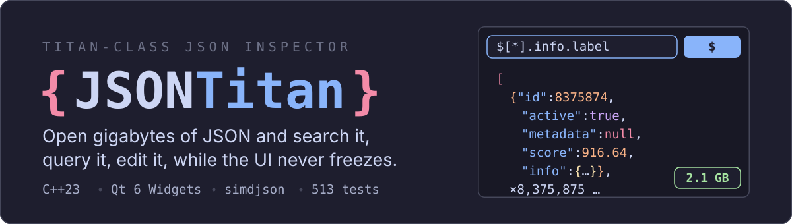
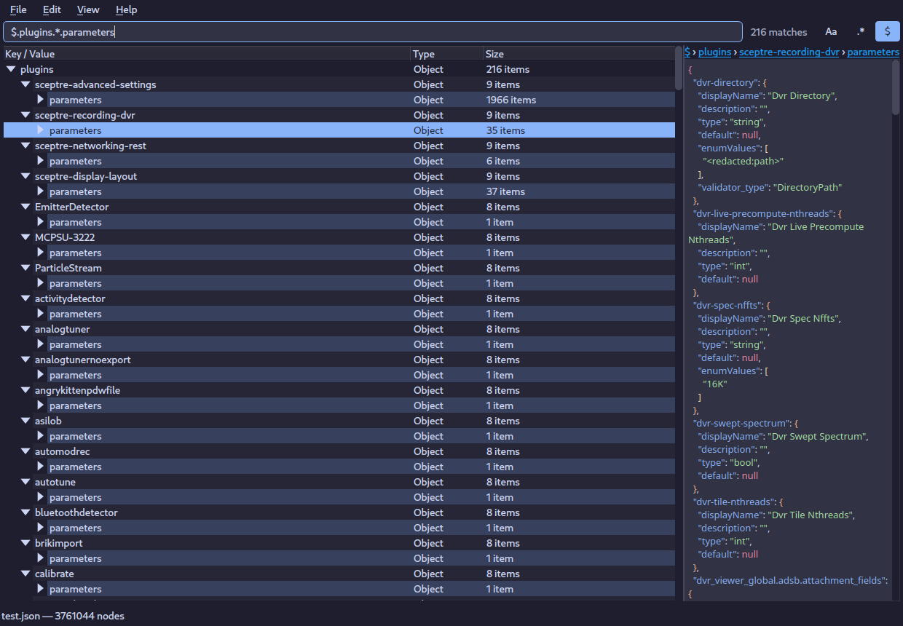
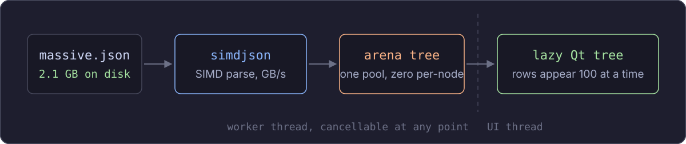
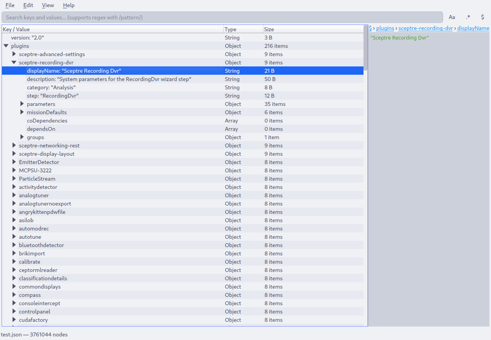

<p align="center">
  
</p>

<p align="center">
  
</p>
<p align="center"><sub>
  A real session: a 137&nbsp;MB / 3.76&nbsp;million-node document, filtered live by the
  JSONPath query <code>$.plugins.*.parameters</code> 216 matches, highlighted and
  navigable with <kbd>F3</kbd>.
</sub></p>

JSONTitan is a Qt 6 desktop app for the JSON files that break other tools.
It opens multi-gigabyte documents into a lazy tree you can search, query with
JSONPath, restructure with undo, and export, while parsing happens on a worker
thread you can cancel at any moment.

## Why it stays responsive

<p align="center">
  
</p>

- **simdjson** parses at SIMD speed on a background thread; progress is live and cancellation takes effect mid-parse.
- Nodes land in a single **memory arena** no per-node heap allocations, and the raw file bytes are released the moment parsing ends.
- The tree view is **lazy**: rows materialize 100 at a time as you expand and scroll, so a 3.7-million-node document opens instantly.
- Viewing, saving, and exporting stream **directly from the arena** nothing is ever deep-copied just to display it.

Verified against a 2.1 GB, 8.4-million-record test document; generate one like it with `python3 tools/genjson.py`.

## What you can do

| | |
|---|---|
| **Search three ways** | Substring, regex, or JSONPath (`$.store.book[*].author`, `..`, `[n]`, wildcards, and filters like `$..book[?(@.price < 10 && @.isbn)].title`) with match count, <kbd>F3</kbd>/<kbd>Shift+F3</kbd> navigation, and highlighted results |
| **Go straight there** | <kbd>Ctrl+G</kbd> jumps to any path (`$.store.book[3].title`, the `$` optional), even in a multi-million-node tree |
| **Edit structure, not just values** | Inline value editing (<kbd>F2</kbd>), add members and elements, paste JSON from the clipboard, edit any subtree (or the whole document) as JSON text, duplicate, reorder, sort keys, rename keys, delete one or many nodes, start a new document. Every change is one undo step (<kbd>Ctrl+Z</kbd>) |
| **Find and replace** | Across string values and/or keys, plain or regex with `$1` groups; numbers and literals are never touched, so a replacement can't break the JSON |
| **Save safely** | Atomic saves, so a failed write never destroys your file, indented with 2 or 4 spaces or minified |
| **Open more than JSON** | JSON Lines / NDJSON (`.jsonl`, `.ndjson`) open as one array of records and save back one record per line (a `.json` holding one record per line opens the same way); JSON with comments (`.jsonc`, or a `.json` like `tsconfig.json` that fails strict parsing) accepts `//` and `/* */` comments and trailing commas. On macOS and Linux all three show up in the file manager's "Open With" |
| **Combine files** | Union multiple documents into one tree, parsed in the background; remove sources again at any time |
| **Export anything** | Whole document or any subtree as JSON, CSV (injection-safe), or XML streamed to disk, never built in memory |
| **Stay oriented** | Breadcrumb path bar, copy key/value/JSONPath to clipboard, type & size columns, expand-to-level controls |
| **Trust the app** | External-change watcher with reload prompt, session restore, unsaved-changes guards everywhere |

Light and dark themes follow the app's Catppuccin palette and persist across sessions:

| Dark (Mocha) | Light (Latte) |
|---|---|
|  |  |

## Build and run

Requires a C++23 compiler, CMake ≥ 3.16, and Qt 6 (`Core`, `Gui`, `Widgets`). simdjson is fetched automatically.

```bash
git clone https://github.com/aedrax/JSONtitan.git
cd JSONtitan
cmake -B build -DCMAKE_BUILD_TYPE=Release && cmake --build build -j
./build/src/shell/JSONTitan your-huge-file.json                                # Linux
./build/src/shell/JSONTitan.app/Contents/MacOS/JSONTitan your-huge-file.json   # macOS
```

Without a build type, CMake compiles without optimization, which slows parsing a lot.

Run the test suite (556 tests: GoogleTest, RapidCheck property tests, Qt Test):

```bash
ctest --test-dir build
```

## Keyboard reference

| Shortcut | Action | Shortcut | Action |
|---|---|---|---|
| <kbd>Ctrl+N</kbd> | New document | <kbd>Ctrl+F</kbd> | Focus search |
| <kbd>Ctrl+O</kbd> | Open | <kbd>F3</kbd> / <kbd>Shift+F3</kbd> | Next / previous match |
| <kbd>Ctrl+S</kbd> | Save (atomic) | <kbd>Ctrl+G</kbd> | Go to path |
| <kbd>F5</kbd> | Reload from disk | <kbd>Ctrl+H</kbd> (macOS <kbd>Cmd+Option+F</kbd>) | Find and replace |
| <kbd>Ctrl+Z</kbd> / <kbd>Ctrl+Shift+Z</kbd> | Undo / redo | <kbd>F2</kbd> | Edit value inline |
| <kbd>Ctrl+Shift+I</kbd> | Add child | <kbd>Ctrl+E</kbd> | Edit as JSON |
| <kbd>Ctrl+I</kbd> | Insert after | <kbd>Ctrl+D</kbd> | Duplicate |
| <kbd>Ctrl+V</kbd> | Paste after selection | <kbd>Ctrl+Shift+V</kbd> | Paste as child |
| <kbd>Alt+Up</kbd> / <kbd>Alt+Down</kbd> | Move node | <kbd>Del</kbd> | Delete node(s) |
| <kbd>Ctrl+Shift+E</kbd> / <kbd>C</kbd> | Expand / collapse all | <kbd>Esc</kbd> | Cancel a running load |

## Architecture

The codebase follows **functional core, imperative shell**:

- `src/core` pure C++, no Qt: parsing (simdjson adapter + a streaming reference parser used as a differential-test oracle), the arena allocator, search and JSONPath engines, immutable edit/delete/replace engines with structural sharing (which is what makes undo nearly free), and streaming exporters.
- `src/shell` Qt 6: a lazy `QAbstractItemModel` over either tree backing, worker-thread loaders with request-generation cancellation, and focused controllers (document session, search, edit, union) around a thin main window.

Everything in the core is exercised by property-based tests; the shell is tested headlessly with Qt Test.

## Limits worth knowing

- Peak memory **during** parsing is a multiple of file size (input + simdjson DOM + arena coexist briefly). Steady-state drops to the arena alone once loading finishes.
- JSONPath covers names, indices, wildcards, `..` and filters; slices (`[1:5]`), unions (`[0,2]`) and function extensions (`length()`) aren't supported, and filter paths take names and indices only.
- Find and Replace and the structural edits work on an in-memory copy of the tree, so the first edit of a multi-gigabyte arena-backed document takes a moment.
- A decimal beyond a double's range (about 1.8e308, such as `1e400`) can't be loaded; the file fails with an error naming the problem.
- Decimal numbers are kept as values, not as the text they were written in: saving writes the shortest form (`1.0` becomes `1`, `1E+2` becomes `100`), so even an unedited file can change when saved. Integers keep every digit, at any size.
- Comments can't survive an edit: saving a file that had them removes them, and the app asks before it does. JSON5 (unquoted keys, single quotes) isn't supported.
- Nesting is capped at 1,024 levels (matching simdjson) so hostile inputs fail with an error instead of a stack overflow.

## Contributing

Issues and pull requests are welcome. Fork, branch, make the tests pass (`ctest --test-dir build`), and open a PR; CI runs the same suite on Ubuntu and macOS.

## License

MIT.
